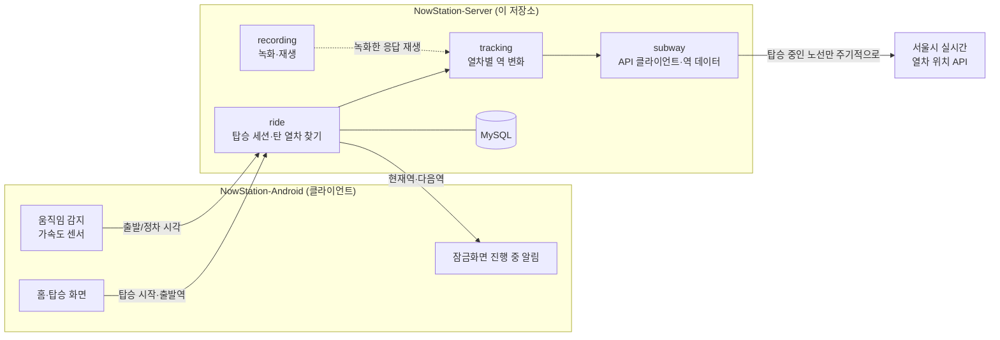

# NowStation Server

지하철에서 **지금 무슨 역인지**를 잠금화면에 보여 주는 앱 NowStation의 서버입니다.
사람이 많아 안내 화면이 안 보이거나 이어폰 때문에 방송이 안 들릴 때, 폰만 켜면 현재역·다음역을 알 수 있게 합니다.
지하에서는 GPS가 안 되기 때문에, 서버가 서울시 실시간 열차 위치를 받아 **사용자가 탄 열차를 찾아 따라갑니다.**

> 진행 중(2026-11-16 ~ 11-22, 7일). 계획과 일정: [docs/PLAN.md](docs/PLAN.md)
> 서버가 어떻게 켜지고, 요청이 어디로 지나가는지 처음부터: [docs/LEARNING.md](docs/LEARNING.md)

## 전체 구조



| 저장소 | 하는 일 | 상태 |
|---|---|---|
| **NowStation-Server** (이 저장소) | 실시간 데이터 받기, 탄 열차 찾기·따라가기, 현재역·다음역 계산, 앱에 알려 주기 | 진행 중 |
| [NowStation-Android](https://github.com/sinadsl1457/NowStation-Android) | 시작 버튼, 움직임 감지, 잠금화면 표시 | 진행 중 |
| NowStation-iOS | 같은 기능(잠금화면·다이내믹 아일랜드) | 다음 단계 |

## 서버 코드 지도

```
src/main/kotlin/com/nowstation/server/
├ NowstationServerApplication.kt   시작점
├ subway/      ✅ 바깥(서울시 API)과 역 데이터
│  ├ SeoulSubwayClient.kt        실시간 API 호출(원문 그대로 받아 옴)
│  ├ RealtimePositionParser.kt   응답 → 열차 위치(노선마다 다른 응답을 한 모양으로)
│  ├ ApiCallBudget.kt            하루 1,000건 한도 세기
│  ├ StationMap(s).kt            노선별 역 순서, 다음 역 계산(2호선 순환·지선 포함)
│  └ SubwayConfig.kt             위 객체들을 Spring에 등록
├ recording/   ✅ 실제 응답 녹화·재생(실기기 없이 테스트·시연하려고)
│  └ Replay*.kt                 재생 모드: 서버 시계를 녹화한 날로, 실시간 API 대신 녹화 응답
├ tracking/    ✅ 받아 온 데이터에서 "열차 ○○이 언제 어느 역에 도착·출발" 사건을 만듦
│  └ TrainTracker.kt             수인분당선처럼 출발 상태가 없으면 다음 역에서 보이는 순간으로 추정
└ ride/        ✅ 탑승
   ├ RideSession.kt              판단 규칙: 탄 열차 찾기(폰 출발 ↔ 열차 출발), 놓친 열차 무시, 환승, 현재역·다음역
   ├ RideRules.kt                판단 기준값 한곳(실기기로 다시 맞출 것)
   ├ RideService.kt              진행 중인 탑승들, 필요한 노선만 받아 오기, 기록 저장
   ├ RidePoller.kt               탑승 중일 때만 15초마다
   ├ RideController.kt           앱용 API
   └ RideRecord.kt               탑승 기록(MySQL, Flyway로 테이블 생성)

src/main/resources/
├ application.properties     설정(키는 .env에서 읽음)
├ db/migration/              테이블 만드는 SQL(Flyway)
└ stations/*.json            노선별 역 순서(scripts/build_stations.py가 녹화와 대조해 생성)

src/test/        규칙 테스트 + 녹화 데이터 재생 시나리오 테스트
scripts/         녹화 분석, 역 데이터 생성(개발용 Python)
docs/PLAN.md     계획·일정
```

의존 방향은 `ride → tracking → subway` 한 방향입니다. 아래쪽은 위쪽을 모릅니다.
판단 규칙(다음 역, 탄 열차 찾기)은 Spring 없이 테스트할 수 있게 순수 Kotlin으로 둡니다.

## API

| 요청 | 하는 일 |
|---|---|
| `GET /api/stations?query=선릉` | 역 이름 검색 → `[{"name":"선릉","lines":["2호선","수인분당선"]}]` |
| `POST /api/rides` `{"originStation":"태평","destinationStation":"강남"}` | 탑승 시작(내릴 역은 없어도 됨) |
| `POST /api/rides/{id}/motion` `{"events":[{"kind":"MOVING","at":"…"}],"sentAt":"…"}` | 폰이 출발·정차한 시각. 폰 시계가 달라도 `sentAt`과의 차이로 맞춘다 |
| `GET /api/rides/{id}` | `{"status":"MOVING","line":"2호선","thisStation":"강남","nextStation":"교대","prepareToAlight":true}` |
| `DELETE /api/rides/{id}` | 탑승 종료 |

`status`: `WAITING`(역에서 기다림) · `AT_STATION`(정차) · `MOVING`(이동) · `HOLDING_BETWEEN`(역 사이 정차) · `STALE`(2분 넘게 소식 없음)

## 요청 하나의 흐름

1. 앱이 탑승을 시작합니다(`POST /api/rides`) → 탑승 세션이 생깁니다.
2. 서버는 **탑승 중인 사람이 있을 때만, 필요한 노선만** 15초마다 받아(`subway`) 열차별 도착·출발을 만듭니다(`tracking`).
3. 앱이 폰의 출발·정차 시각을 보내면(`…/motion`), 그 출발 즈음 기다리던 역을 떠난 열차를 **탄 열차**로 정합니다(`ride`).
   열차를 놓쳤으면 그 열차가 떠날 때 폰이 멈춰 있었으니 무시하고, 내 열차가 떠날 때 폰이 멈춰 있었으면 내린 것(환승)으로 봅니다.
4. 앱이 현재역·다음역을 받아 잠금화면에 보여 줍니다(`GET /api/rides/{id}`).

## 테스트
- 판단 규칙: 정상 탑승, 열차 놓침, 5분 임시 정차, 환승, 역 사이 정차, 데이터 끊김, 하차 알림
- **실제 녹화 데이터 시나리오**(2026-11-16 오전): 태평에서 6064 놓치고 6518 탑승 / 한티→선릉 하차→2호선 3154 환승→강남 직전 알림
- 통합: 서버+MySQL을 띄우고 녹화를 시계에 맞춰 돌려 위 환승을 API로 끝까지
- **에뮬레이터 화면까지(시연 장치)**: 아래 "실기기 없이 화면까지 돌려 보기"

## 실기기 없이 화면까지 돌려 보기

`scripts/demo/run_scenario.py`가 하는 일:
1. 서버를 **재생 모드**로 켠다 → 서버 시계가 녹화한 날(2026-11-16 오전)의 시각으로 실제 속도로 흐르고, 서울시 API 대신 그 시각의 녹화 응답을 쓴다
2. 에뮬레이터의 앱에서 역을 골라 탑승을 시작한다(adb로 누름)
3. 녹화 속 시각에 맞춰 **가속도 센서 값을 넣는다**(출발 = 10초 가속, 도착 = 10초 감속) → 앱의 움직임 판단이 출발·정차를 잡아 서버로 보냄
4. 지하 끊김은 에뮬레이터 Wi-Fi·데이터를 끈다
5. 정해 둔 순간마다 **화면 글자를 읽어 기대값과 비교**하고 스크린숏을 남긴다(`build/demo/<시나리오>/`)

| 시나리오 | 확인 지점 | 결과(2026-11-16) |
|---|---|---|
| `missed` 태평에서 6064 놓치고 6518 탑승 | 기다림 → 6064 떠나도 기다림 → 가천대 정차·다음 역 복정 | 3/3 통과 |
| `yatap` 태평에서 6073 → 모란 → 야탑 직전 알림 | 기다림 → 이번 역 모란·다음 역 야탑 → "내릴 준비하세요" | 3/3 통과 |
| `transfer` 한티 → 선릉 하차(중간 끊김) → 2호선 → 강남 직전 알림 | 기다림 → 끊김 표시 → 선릉 환승 대기 → 역삼 → "내릴 준비하세요" + 진동 | 5/5 통과, 진동(알람 용도 1.6초) 기록 확인 |

```bash
# 8080을 쓰는 서버는 끄고, 에뮬레이터에 앱을 설치한 뒤
python3 scripts/demo/run_scenario.py transfer   # 약 10분(녹화 09:45~09:55를 실제 속도로)
python3 scripts/demo/run_scenario.py missed     # 약 13분
python3 scripts/demo/run_scenario.py yatap      # 약 7분
```
실제 속도로 돌기 때문에 도중에 맥이 잠자기에 들어가면 시각이 어긋난다(실제로 한 번 실패) → 스크립트가 끝날 때까지 맥을 깨워 두고, 5초 넘게 늦은 단계가 있으면 멈춘다.
한계: 센서 값은 깨끗한 계단 모양이라 실제 지하철 흔들림은 재현하지 못한다. 움직임 판단 기준값은 실기기로 다시 맞춰야 한다.

## 확인한 데이터 사실 (1일차 실측)
- 열차 상태는 진입·도착·출발. **수인분당선은 출발을 주지 않습니다.**
- 데이터는 실제보다 보통 30~50초 늦습니다.
- 역 ID는 노선 안에서 연속 번호라 역 순서를 데이터로 만들 수 있습니다.
- 방향 값(`updnLine`)의 뜻을 녹화한 실제 이동 92건으로 확인했습니다.

자세한 내용은 [CLAUDE.md](CLAUDE.md)에 있습니다.

## 실행

필요: JDK 25, Docker

```bash
cp .env.example .env          # 서울 열린데이터광장 "실시간 지하철 인증키"를 넣는다
./gradlew bootRun             # 로컬 MySQL은 Docker로 자동 실행된다
./gradlew test                # 테스트(Testcontainers로 MySQL을 띄운다)

# 실제 운행 데이터 녹화(1시간, 3개 노선 20초 간격 ≈ 540건)
./gradlew bootRun --args='--recording.enabled=true --recording.duration=PT60M --server.port=8081'
```
