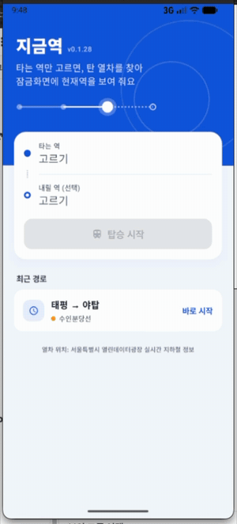
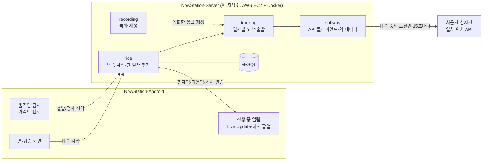

# NowStation Server (지금역)

지하철에서 **지금 무슨 역인지**를 잠금화면에 보여 주는 앱 NowStation의 서버입니다.
사람이 많아 안내 화면이 안 보이거나 이어폰 때문에 방송이 안 들릴 때, 폰만 보면 현재역·다음역과 내릴 역 알림을 받을 수 있습니다.

지하에서는 GPS가 안 됩니다. 시간표로 추정하면 열차를 놓치거나 열차가 멈춰 서는 순간 틀립니다.
그래서 서버가 **서울시 실시간 열차 위치**를 받아, 폰이 출발한 순간 그 역을 떠난 열차를 **사용자가 탄 열차**로 찾아 따라갑니다.

클라이언트: [NowStation-Android](https://github.com/sinadsl1457/NowStation-Android) · [NowStation-iOS](https://github.com/sinadsl1457/NowStation-iOS)(개인 테스트용, APNs 없이 Live Activity)

<p align="center"></p>

<p align="center"><sub>2026-11-16 오전에 녹화한 실제 열차 위치를 재생 서버로 흘리고, 에뮬레이터 센서에 열차 출발·정차를 넣어 찍은 장면(6분 23초 → 36초 요약, <a href="docs/demo/nowstation-demo.mp4">mp4</a>)</sub></p>

## 핵심 아이디어: "어느 열차를 탔나"를 시간표가 아니라 실제 움직임으로

```
서울시 데이터   6073 태평 도착 09:46:55 ─────────── 6073 모란 진입 09:47:55 → "태평을 떠났다"
폰 가속도 센서                  폰 출발 09:47:05 ↗
서버 판단       6073이 태평을 떠난 앞뒤(09:44:55~09:48:10)에 폰도 출발했다 → 6073에 탔다
```
- **열차를 놓치면:** 그 열차가 떠날 때 폰은 가만히 있었으니 따라가지 않습니다.
- **내리면(환승):** 내 열차는 떠났는데 폰이 가만히 있으면 내린 것으로 봅니다. 그 역에서 다음에 폰과 같이 출발한 열차를 따라갑니다(노선 무관).
- **멈춰 서면:** 실제 위치를 보여 주니 "역 사이 정차"도 그대로 나옵니다.

## 기술적으로 신경 쓴 부분

| 문제 | 해결 |
|---|---|
| 지하에서는 GPS가 없고, 시간표로는 열차 놓침·지연·임시 정차를 반영하지 못함 | 실시간 열차 위치(서울시 API)와 폰 가속도 센서의 출발·정차 시각을 맞춰 **탄 열차를 찾아 따라감** |
| 승강장에서 폰이 흔들린 순간 반대편 열차가 떠나면 그 열차를 탄 것으로 고름(시연 중 발견: 태평 → 야탑인데 가천대 방면을 따라감) | 내릴 역이 같은 노선에 있으면 그 역으로 가는 방향의 열차만 후보로 봄. 갈아타는 경로나 2호선 순환은 방향만으로 거를 수 없어 그대로 둠 |
| 수인분당선은 "출발" 상태를 주지 않음 | 다음 역에 진입으로 보이는 순간으로 출발을 추정. 그만큼 늦게 알게 되므로 폰 출발을 찾는 범위를 그 역 도착부터 잡음(실제 녹화 데이터로 찾은 버그, 실패하는 테스트로 고정 후 수정) |
| 데이터가 실제보다 30~50초 늦음(1일차 실측) | 내릴 역 알림을 "그 역에 다가가는 중"이 보이는 순간에 냄 |
| 실시간 API 하루 1,000건 | 탑승 중인 사람이 있는 노선만, 같은 노선은 모든 탑승이 한 번만 받아 공유. 앱 소식이 10분 없으면 탑승 정리(강제 종료된 앱이 한도를 쓰지 않게). 남은 호출이 적으면 자정까지 버티게 간격을 늘림 |
| 폰 시계가 서버와 다르고, 지하에서 끊겨 움직임이 늦게 올라옴 | 폰이 "보낸 시각과의 차이"만 믿어 서버 시각으로 바꿈. 늦게 온 움직임도 일어난 시각대로 판단 |
| 실기기 없음(Android 실기기·유료 Apple 계정 없음) | 출근 시간 실제 응답을 녹화 → **서버 재생 모드**(시계·데이터 출처만 바꿔 끼움) + 에뮬레이터 센서·네트워크 조작 + 화면·알림 글자 자동 대조 |
| 판단 규칙이 복잡해 Spring과 섞이면 테스트가 느리고 어려움 | 규칙(`RideSession`, `TrainTracker`, `StationMap`)은 순수 Kotlin, 시간은 주입한 `Clock`. 실제 녹화 데이터를 흘려 시나리오 테스트 |
| 배포 서버 메모리 1GB, 맥(Arm)과 서버(x86) 구조가 다름 | 이미지는 맥에서 x86용으로 만들어 보냄(서버에서 Gradle 빌드 안 함). MySQL 버퍼·서버 메모리 한도, 스왑 2GB |

## 전체 구조



## 서버 코드 지도

```
src/main/kotlin/com/nowstation/server/
├ subway/      바깥(서울시 API)과 역 데이터
│  ├ SeoulSubwayClient.kt        실시간 API 호출
│  ├ RealtimePositionParser.kt   노선마다 다른 응답 → 열차 위치 한 모양
│  ├ ApiCallBudget.kt, PollPacing.kt   하루 한도 세기, 남은 수로 간격 정하기
│  └ StationMap(s).kt            노선별 역 순서, 다음 역(2호선 순환·지선 포함)
├ tracking/    TrainTracker.kt   받아 온 데이터 → "열차 ○○이 언제 어느 역에 도착·출발"
├ ride/        탑승
│  ├ RideSession.kt              판단 규칙: 탄 열차 찾기, 놓친 열차 무시, 환승, 현재역·다음역
│  ├ RideRules.kt                판단 기준값 한곳
│  ├ RideService.kt              진행 중인 탑승들, 필요한 노선만 받아 오기, 버려진 탑승 정리
│  ├ RidePoller.kt               탑승 중일 때만 15초마다
│  ├ RideController.kt           앱용 API
│  └ RideRecord.kt               탑승 기록(MySQL, Flyway)
└ recording/   실제 응답 녹화와 재생 모드(Replay*.kt)
```
의존 방향은 `ride → tracking → subway` 한 방향입니다.

## API

| 요청 | 하는 일 |
|---|---|
| `GET /api/stations?query=선릉` | 역 검색 → `[{"name":"선릉","lines":["2호선","수인분당선"]}]` |
| `GET /api/lines` | 지원 노선 → `["2호선","수인분당선","신분당선"]` |
| `POST /api/rides` `{"originStation":"태평","destinationStation":"야탑"}` | 탑승 시작(내릴 역은 선택) |
| `POST /api/rides/{id}/motion` `{"events":[{"kind":"MOVING","at":"…"}],"sentAt":"…"}` | 폰이 출발·정차한 시각(끊긴 동안 쌓인 것을 한꺼번에) |
| `GET /api/rides/{id}` | `{"status":"MOVING","line":"수인분당선","thisStation":"야탑","nextStation":"이매","prepareToAlight":true}` |
| `DELETE /api/rides/{id}` | 탑승 종료 |

`status`: `WAITING`(역에서 기다림) · `AT_STATION`(정차) · `MOVING`(이동) · `HOLDING_BETWEEN`(역 사이 정차) · `STALE`(2분 넘게 소식 없음)

## 테스트와 시연

**서버 테스트 59개**
- 판단 규칙: 정상 탑승, 열차 놓침, 반대 방향 열차 거름, 5분 임시 정차, 환승, 역 사이 정차, 데이터 끊김, 늦게 온 움직임, 하차 알림
- 실제 녹화 데이터(2026-11-16 오전) 시나리오: 태평에서 6064 놓치고 6518 탑승 / 한티 → 선릉 하차 → 2호선 3154 → 강남 직전 알림
- 통합(Spring + MySQL을 Testcontainers로): 위 환승을 API로 끝까지, 버려진 탑승 정리
- 한도: 간격 계산, 서울 자정 기준 초기화

**에뮬레이터 화면까지 (`scripts/demo/run_scenario.py`)**

재생 모드 서버 + 녹화 시각에 맞춘 센서 주입 + 화면·알림 글자 대조를 한 번에 돌립니다.

| 시나리오 | 확인한 것 | 결과 |
|---|---|---|
| `missed` | 6064가 왔다 가도 기다림 → 폰 출발에 6518 탑승 → 가천대 | 3/3 |
| `yatap` | 기다림 → 이번 역 모란 → "내릴 준비하세요" | 3/3 |
| `yatap --mode=background` | YouTube를 보는 중에도 알림 갱신, 상태 표시줄 칩, YouTube 위로 하차 팝업, 진동 | 3/3 |
| `yatap --mode=locked` | 잠긴 폰에서 알림 갱신, 진동, 잠금화면 표시 | 3/3 |
| `transfer` | 지하 끊김 표시 → 선릉 하차·환승 → 2호선 → 강남 직전 알림 | 5/5 |

```bash
# 앱은 이 컴퓨터의 재생 서버를 보게 설치: NowStation-Android에서
#   ./gradlew installDebug -PAPI_BASE_URL=http://10.0.2.2:8080/
python3 scripts/demo/run_scenario.py yatap                     # 약 7분(녹화를 실제 속도로)
python3 scripts/demo/run_scenario.py yatap --mode=story --record  # 시연 영상 녹화
```

## 한계와 다음

- **움직임 판단 기준값은 실기기로 다시 맞춰야 합니다.** 센서 값은 합성 신호와 에뮬레이터 주입으로만 확인했습니다(`RideRules`, 앱의 `MotionRules` 한곳에 모음).
- 노선은 2호선·수인분당선·신분당선 3개입니다. 역 데이터는 녹화와 대조해 만드는 스크립트(`scripts/build_stations.py`)로 늘릴 수 있습니다.
- 하루 호출 수를 메모리에서 셉니다(재시작하면 0부터, 여유분 50건).
- iOS(잠금화면 Live Activity·다이내믹 아일랜드)는 다음 단계입니다.

## 기술 스택

Kotlin · Spring Boot 4 (Web MVC, Data JPA, Validation, Actuator, Scheduling) · MySQL 8.4 · Flyway · Jackson 3 · RestClient · JUnit 5 · Testcontainers · Docker · AWS EC2

## 실행

필요: JDK 25, Docker

```bash
cp .env.example .env          # 서울 열린데이터광장 "실시간 지하철 인증키"
./gradlew bootRun             # 로컬 MySQL은 Docker로 자동 실행
./gradlew test

# 배포는 main에 push하면 자동(아래 "배포")

# 실제 운행 데이터 녹화(1시간, 3개 노선 20초 간격 ≈ 540건)
./gradlew bootRun --args='--recording.enabled=true --recording.duration=PT60M --server.port=8081'
```

## 배포 (CI/CD)

**main에 push하면 끝입니다.** 사람이 서버에 들어가지 않습니다.

```
push ─→ [GitHub Actions] 테스트 59개 → 이미지(이름표 = 커밋 번호)를 GHCR에 올림
                                                     │
        [EC2] 1분마다 "main 이미지가 바뀌었나?" ←──────┘  (pull 방식: GitHub은 서버에 들어오지 않음)
              바뀌었으면 받아서 서버만 교체 → 2분 안에 UP이 아니면 이전 이미지로 되돌림
                                                     │
        [GitHub Actions] https /actuator/info의 버전이 이번 커밋이 될 때까지 확인 ─→ 초록 체크 / 빨간 X
```

> **pull 방식을 쓴 이유:** 유료 계정이라면 보통 GitHub OIDC로 임시 권한을 받아 SSM으로 서버에 배포를 지시하는 push 방식으로 만들지만, 이 프로젝트는 AWS 무료 플랜이라 OIDC 연결 생성이 조직 정책(SCP)으로 막혀 있어(`iam:CreateOpenIDConnectProvider` 거부) 서버가 스스로 가져가는 방식을 택했습니다.

| 결정 | 이유 |
|---|---|
| **pull 방식**(서버가 가져감) | GitHub에 서버 접속 키·AWS 키를 두지 않고, SSH는 내 IP만 열어 둔다 |
| 실패한 버전 기억 | 되돌린 버전을 다음 확인 때 또 깔면 매분 끊긴다 → 그 커밋은 다시 시도하지 않음 |
| GitHub이 버전으로 확인 | 서버의 읽기 토큰이 만료되거나 타이머가 멈추면 조용히 배포가 멈춘다 → 8분 안에 안 바뀌면 빨간 X |
| **배포 뒤 탑승 이어 가기** | 진행 중인 탑승은 서버 메모리에 있어 교체하면 사라진다(앱에 "탑승을 잃음"). 단계(기다림/탑승 중, 열차 번호)를 바뀔 때마다 DB에 적고, 새 서버는 모르는 탑승을 DB로 다시 만든다. 앱 소식이 10분 넘게 없던 탑승은 이어 가지 않음 |
| 설정 파일도 이미지 안에 | compose·Caddyfile·정적 페이지·배포 스크립트를 이미지에 담아, 코드와 설정 버전이 항상 같게 |

서버 구성: AWS EC2(t3.micro, x86, 메모리 1GB + 스왑 2GB, 고정 IP)에 Docker로 서버 + MySQL + Caddy(`compose.prod.yaml`).
https는 Caddy가 무료 주소(`<IP를 -로 이은>.sslip.io`)로 Let's Encrypt 인증서를 자동으로 받고 갱신합니다.

처음 한 번(새 EC2):
1. EC2 생성(Amazon Linux 2023), 탄력적 IP 연결. 보안 그룹: SSH는 내 IP만, 80·443은 모두
2. EC2에 Docker·compose 설치, 스왑 2GB
3. EC2 `~/nowstation/.env`에 `SEOUL_SUBWAY_KEY`, `DB_PASSWORD`, `DB_ROOT_PASSWORD`, `DOMAIN`
4. `docker login ghcr.io`(GitHub classic 토큰, `read:packages`만)
5. `scripts/auto-deploy.sh` → `~/nowstation/`, `infra/ec2/nowstation-deploy.{service,timer}` → `/etc/systemd/system/`, `systemctl enable --now nowstation-deploy.timer`

확인: `journalctl -u nowstation-deploy -n 50`(배포 기록), `systemctl list-timers nowstation-deploy`

## 문서
- [docs/PLAN.md](docs/PLAN.md): 7일 계획과 위험
- [CLAUDE.md](CLAUDE.md): 실측한 데이터 사실, 구조 규칙, 작업 방식
